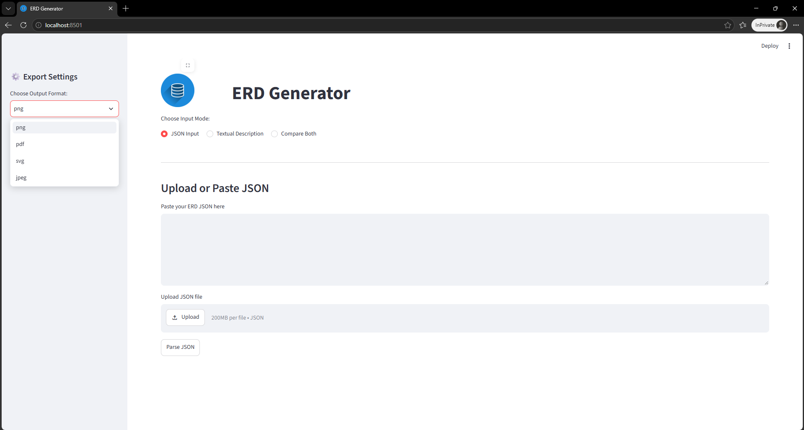
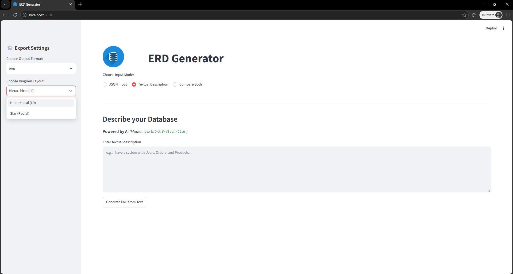
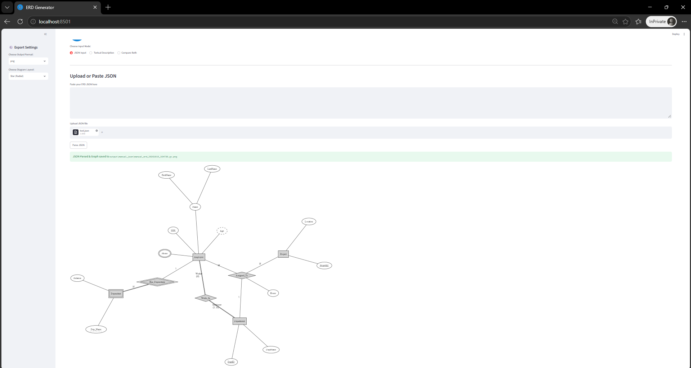
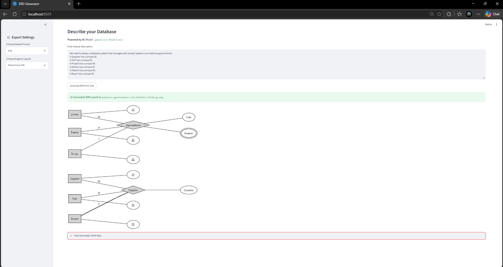

# ER Diagram Generator

**Course:** CSE-471 Database Systems (Lab 1)

## 📌 Overview
This project is an automated tool that generates Entity-Relationship Diagrams (ERDs) directly from text or JSON. It uses a Python script to convert JSON data into professional Graphviz diagrams. It also uses Google's **Gemini AI** (`gemini-3.5-flash-lite`) to understand plain English descriptions and automatically turn them into the required JSON format, making the database design process effortless.
### 🖥️ GUI Preview

**1. JSON Input Mode**


**2. Text-to-ERD Mode (AI-Powered)**

---

## ✨ Features
- **Intelligent Parsing:** Parses complex JSON structures using strict `Pydantic` schemas.
- **AI-Powered Generation:** Converts plain English descriptions directly to ER Diagrams using Gemini API.
- **Interactive GUI:** User-friendly web interface built with `Streamlit` supporting 3 modes:
  1. **JSON Input:** Paste or upload a JSON file to render the ERD.
  2. **Textual Description:** Describe your database in plain English, and the AI generates the ERD.
  3. **Compare Both:** Side-by-side comparison of manual JSON vs. AI-generated output.
- **Advanced ERD Support:**
  - N-ary relationships (Ternary, 4-ary, etc.).
  - Weak entities and identifying relationships.
  - Relationship structural constraints and entity roles.
  - Multi-valued, derived, composite (recursive), and partial key attributes.
  - Total/Partial participation and precise cardinality ratios (configured as a per-entity list).

---

## 🤖 AI Model Selection & Challenges

Connecting the Gemini API came with a couple of practical challenges that shaped our design:

* **Avoiding `503 High Demand` Errors:** Early tests with standard models like **`gemini-3.5-flash`**, **`gemini-3.6-flash`**, and **`gemini-3.8-flash`** often failed due to traffic spikes and `503 Service Unavailable` errors. Switching to **`gemini-3.5-flash-lite`** solved this, offering fast response times and dependable uptime.
* **Guaranteeing Valid JSON:** To prevent missing keys or formatting mistakes that would crash the Graphviz renderer, we locked down the AI's output using `response_schema` in the Google GenAI SDK. This forces the model to return clean, valid JSON matching our Pydantic schema every single time.  
- **Reference:** [Google Cloud Docs - Control generated output with response schemas](https://docs.cloud.google.com/gemini-enterprise-agent-platform/models/capabilities/control-generated-output#googlegenaisdk_ctrlgen_with_resp_schema-python_genai_sdk)
---
## 🧠 AI Prompt Engineering

To ensure the Gemini AI accurately extracts complex database constraints and outputs them in our exact JSON schema, we use the following highly-structured prompt:

```python
prompt = f"""
You are an expert database designer and data modeler.
Analyze the following system description and extract the Entity-Relationship Diagram (ERD) components:
- Entities (with their attributes, primary keys, and whether they are weak entities).
- Relationships (connecting entities, cardinality, participation, and any relationship attributes).
- In a relationship, the entities list, cardinality list, participation list, and roles list must all follow the exact same order.
- cardinality has one value per entity: "1", "N" or "M" (e.g. ["N","1"] or ["M","N","1"]).
- participation has one value per entity: "total" if every instance must participate, otherwise "partial".
- roles (optional): has one value per entity representing its role in the relationship (e.g. ["Worker", "Employer"]). If no specific roles are mentioned, leave the list empty.
- A weak entity always has total participation in its identifying relationship.
- minCardinality/maxCardinality are per entity, in the same order as the entities. Fill an entity's slot ONLY if the description gives explicit numeric bounds for that specific entity (e.g. "between 5 and 50 employees"). For every other entity use "" in both lists. If no entity has explicit bounds, leave both lists null.

System Description:
"{system_description}"
"""
```
---
## 🖼️ Gallery

### Generated ERD Samples

| Complex Database Model | N-ary |
|:---:|:---:|
|  |  |


---

## 🛠️ Installation & Run Steps

1. **Clone the repository or extract the project files:**
   Ensure you have Python 3.8+ installed on your system.
   Also, ensure that **Graphviz** is installed on your OS and added to your system's PATH.

2. **Install the required Python libraries:**
   ```bash
   pip install -r requirements.txt
   ```

3. **Set up the Environment Variables:**
   Create a `.env` file in the root directory and add your Google Gemini API Key:
   ```env
   GEMINI_API_KEY=your_google_gemini_api_key_here
   ```

4. **Run the Streamlit Application:**
   ```bash
   python -m streamlit run app.py
   ```
   The application will open automatically in your default web browser at `http://localhost:8501`.

---
## 🧠 ERD Mapping Rules (Graphviz Rendering)

The rendering engine (`diagram_renderer.py`) dynamically maps the Pydantic schema components into Graphviz shapes following standard Database System notations:

| Category | Component | Graphviz Rendering & Styling |
| :--- | :--- | :--- |
| **Layout Engines** | **Hierarchical (LR)** | Standard directed flow (left-to-right) using the `dot` engine, ideal for clean, readable pipelines. |
| | **Star / Radial** | Spring-model layout using the `neato` engine (`overlap='false'`), spreading radially from the center. |
| **Entities** | **Regular Entity** | Standard **Rectangle** (`shape='rectangle'`). |
| | **Weak Entity** | **Double Rectangle** (`peripheries='2'`). |
| **Relationships** | **Regular Relationship** | Standard **Diamond** (`shape='diamond'`). |
| | **Identifying** | **Double Diamond** (`peripheries='2'`). |
| | **Total Participation** | **Double Line** (`color='black:black'`) connecting entity to relationship. |
| | **Partial Participation** | Standard single line. |
| | **Cardinality** | Displayed directly on edges (e.g., `(1)`, `(N)`, `(M..N)`). |
| | **Entity Roles** | Displayed above the cardinality ratio when specified (e.g., `Worker (N)`). |
| **Attributes** | **Regular Attribute** | Standard **Ellipse**. |
| | **Primary Key** | Ellipse with **underlined** text. |
| | **Partial Key** | Ellipse with a **dotted underline** (using Graphviz HTML-like labels). |
| | **Multi-Valued** | Ellipse with a **double border** (`peripheries='2'`). |
| | **Derived** | Ellipse with a **dashed border** (`style='dashed'`). |
| | **Composite** | A recursive tree of sub-ellipses branching out from the parent attribute. |

---
## 🏗️ Pydantic Schema Architecture

The core of the application relies on strict data validation using `Pydantic` (`schemas.py`):

```python
class Attribute(BaseModel):
    name: str
    isPrimaryKey: bool = False
    isMultiValued: bool = False
    composite: Optional[List['Attribute']] = None
    isPartialKey: bool = False
    isDerived: bool = False

class Entity(BaseModel):
    name: str
    attributes: List[Attribute] = Field(default_factory=list)
    weak: bool = False

class Relationship(BaseModel):
    name: str
    entities: List[Entity] = Field(default_factory=list)  
    cardinality: List[str] = Field(default_factory=list)
    participation: List[str] = Field(default_factory=list)
    roles: List[str] = Field(default_factory=list)
    attributes: List[Attribute] = Field(default_factory=list)
    identifyingRelationship: bool = False
    minCardinality: Optional[List[str]] = None 
    maxCardinality: Optional[List[str]] = None
```


---

## 📚 Libraries Used (`requirements.txt`)
- `pydantic`: For strict data validation and JSON parsing.
- `graphviz`: For programmatically rendering the ER Diagram.
- `google-generativeai`: The official Google SDK to communicate with the Gemini AI API.
- `streamlit`: To build the interactive Graphical User Interface (GUI).
- `python-dotenv`: For managing sensitive API keys via `.env` files.